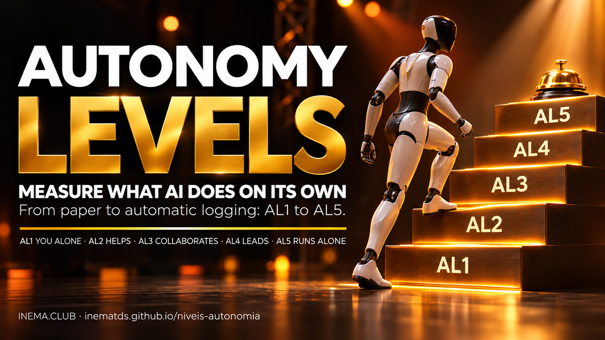

# Autonomy Levels

[](https://inematds.github.io/niveis-autonomia/guia/en/)

**🇧🇷 [Português](README.md) · 🇺🇸 [English](README.en.md) · 🇪🇸 [Español](README.es.md)**

## What it is

A kit for measuring how much freedom you gave AI for each task, on the **AL1 to AL5** scale: from AL1 (you do it yourself) to AL5 (AI runs on its own, on a schedule, with rules and an alert). It is the same scale as the [nivel-ia](https://inematds.github.io/nivel-ia/guia/) kit; this one looks at freedom: permission mode, what the AI changed outside the machine, and where the trigger to call a human needs to exist. It is for people who use AI at work and want to know what they still do by hand and what they can already hand off. You start with a paper form; Claude Code users can enable an automatic log that reads their own sessions, classifies each one, and records every connection used. Requires Python 3 and, for automatic logging, Claude Code history.

## 📖 User guide

Complete guide (landing page + step-by-step): **https://inematds.github.io/niveis-autonomia/guia/en/**

## The AL1 to AL5 scale

| Level | Name | AI does | You do |
|---|---|---|---|
| AL1 | You do it yourself | Nothing | Everything |
| AL2 | AI helps | Responds and suggests | Decides and executes |
| AL3 | AI collaborates | Works together, step by step | Guides each step |
| AL4 | AI leads, you review | Prepares everything | Checks before it goes out |
| AL5 | AI runs on its own | Runs the process on a schedule, with rules and an alert | Reads the summary and handles exceptions |

**Does AL5 have a trigger to call a human?** Yes, and it needs one: the alert calls you when a task goes outside the rules. The report lists AL5 sessions that changed something outside the machine (published, sent, uploaded) so you can check whether each one has rules, a limit, and an alert.

Details and criteria in [NIVEIS.md](NIVEIS.md).

## The process, from start to finish

1. 🧠 **Understand the scale** (10 min): read [NIVEIS.md](NIVEIS.md) or the guide.
2. 🧠 **Print the form**: `kit/ficha-papel.html` (also `.en.html` and `.es.html`), landscape A4.
3. 🧠 **Take notes for 5 days**: one line per task (date, task, level AL1 to AL5, connection, did I correct it?, serious error?).
4. 🧠 **Wrap up on Friday** (5 min): instructions in [kit/ficha-papel.md](kit/ficha-papel.md).
5. ⚙️ **Scan the logs**: `python3 medir/autonomia.py varrer --desde YYYY-MM-DD`.
6. ⚙️ **View the report**: `python3 medir/autonomia.py relatorio` (levels per week, repeated tasks, AL5 sessions that changed something outside the machine).
7. ⚙️ **List the connections**: `python3 medir/autonomia.py conexoes` and `inventario`.
8. ⚙️ **Keep it running**: `sh systemd/instalar.sh` (daily timer at 06:10, saves `registro/ultimo-relatorio.md`).
9. 🧠 **Check the trigger to call a human**: every entry under “AL5 sessions that changed something outside the machine” needs rules, a limit, and an alert.
10. 🧠 **Move a task up one level**: choose the most repeated and safest task, using the criteria in [NIVEIS.md](NIVEIS.md); measure again the following week.
11. 🧠 **Move down a level after a mistake**: 1 serious error or 3 major corrections in the last 10 runs → go down one level. Critical tasks stop at AL4.

🧠 session with the person · ⚙️ script or timer.

## Tests

```bash
python3 -I -m unittest discover -s tests
```

## Privacy

Everything runs locally, without calling an API. The log is stored in `registro/` (outside git). The inventory lists names only, never keys or addresses. The `exemplo/` folder contains aggregated numbers only.

## Limits

It cannot tell whether you approved something in the prompt (only the permission mode); API calls inside scripts appear as `bash:python3`; it does not read Codex (the [nivel-ia](https://inematds.github.io/nivel-ia/guia/) kit does); AL1 exists only on the form; the level measures freedom, not correctness.

---
Part of [INEMA.CLUB](https://inema.club). Open and free content.